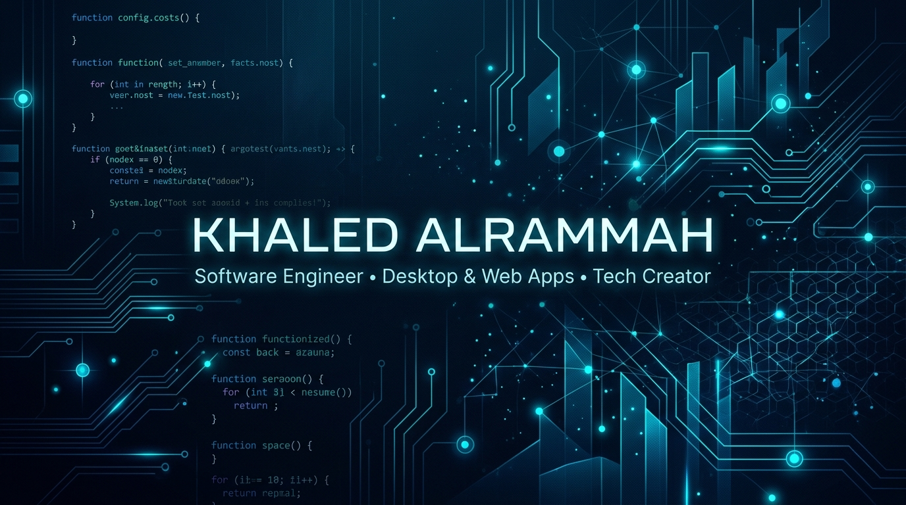

div align="center">

  

    

  

  # خالد الرماح | Khaled Alrammah
  ### 💻 مهندس برمجيات ومطور تطبيقات سطح المكتب والويب | مؤسس مدونة تيك ماكس (TekMax)
  **Software Engineer • Desktop & Full-Stack Developer • Tech Content Creator**

  

    
    &nbsp;
    
    &nbsp;
    
    &nbsp;
    
  

---

### 🌟 نبذة شخصية وسيرة ذاتية (About Me & Bio)

مرحبًا بك في مساحتي التقنية على GitHub! أنا **خالد الرماح (Khaled Alrammah Abu Raqiqa)**، مطور برمجيات شغوف بتطوير التطبيقات الآمنة وعالية الأداء لنظام سطح المكتب والويب. 

أهتم بالهندسة المعمارية النظيفة للبرمجيات، وحماية البيانات محلياً، وبناء تجارب مستخدم عربية عصرية وسلسة بالكامل (Full RTL Support). كما أشارك خبراتي وأحدث الحلول التقنية وقوالب الويب من خلال مدونتي التقنية **[تيك ماكس | TekMax](https://tek-max.blogspot.com)**.

- 🔭 **أعمل حاليًا على:** تطوير وتوسيع تطبيق **[رَصيدي (Raseedi)](https://github.com/kaled75/raseedi)** لإدارة المعاملات والديون الشخصية بأعلى معايير المحاسبة والأمان المحلي.
- 💡 **مجالات الاهتمام:** هندسة تطبيقات سطح المكتب (Electron Desktop Apps)، تطوير واجهات React و Vite، قواعد البيانات المدمجة (SQLite)، وأمن المعلومات وحماية الخصوصية.
- ✍️ **صناعة المحتوى التقني:** كاتب ومؤسس مدونة **[تيك ماكس](https://tek-max.blogspot.com)** المتخصصة في الشروحات البرمجية، وتطوير قوالب الويب، وأدوات المطورين.
- 💬 **تواصل معي بخصوص:** مشاريع React و Electron، استشارات تطوير القوالب والأدوات البرمجية، والأفكار التقنية الملهمة.

---

### 🛠️ المهارات والتقنيات (Skills & Technologies)

| الفئة (Category) | التقنيات والأدوات |
| :--- | :--- |
| **لغات البرمجة (Languages)** |       |
| **أطر العمل والمكتبات (Frameworks)** |      |
| **قواعد البيانات (Databases)** |   |
| **الأدوات وبيئة العمل (Tools & DevOps)** |     |

---

### 🚀 أبرز المشاريع المنفذة (Featured Projects)

<table>
  <tr>
    <td width="50%" valign="top">
      <h3>🪙 <a href="https://github.com/kaled75/raseedi">رَصيدي | Raseedi</a></h3>
      
تطبيق مكتبي متكامل واحترافي لإدارة الديون الشخصية، يتميز بأمان تشفير محلي PBKDF2، ومحاذاة محاسبية دقيقة تمنع تجاوز الرصيد المتبقي، مع دعم كامل للغة العربية وتصدير تقارير HTML و Excel مستقلة.

      

        
        
        
      

    </td>
    <td width="50%" valign="top">
      <h3>⚡ <a href="https://github.com/kaled75/BlogTekMax-Pro">BlogTekMax Pro</a></h3>
      
قالب بلوجر عصري وفائق السرعة لعام 2026، مصمم للمدونات التقنية الحديثة مع نظام تخصيص فوري، وتوافق تام مع محركات البحث SEO ومعايير السرعة القياسية.

      

        
        
        
      

    </td>
  </tr>
  <tr>
    <td width="50%" valign="top">
      <h3>🔒 <a href="https://github.com/kaled75/Digital-safe">Digital Safe (الخزنة الرقمية)</a></h3>
      
تطبيق أمني عالي الحماية لإدارة وتشفير كلمات المرور والحسابات الحساسة بسهولة ومحلياً، مع واجهة أنيقة باللغة العربية وتجربة استخدام خالية من التعقيد.

      

        
        
      

    </td>
    <td width="50%" valign="top">
      <h3>🛠️ <a href="https://github.com/kaled75/Blogger-Code-Generator">Blogger Code Generator</a></h3>
      
أداة تفاعلية متخصصة لمطوري ومحرري المواقع لتوليد وتخصيص أكواد الويب المتقدمة وتنسيقات CSS ووسوم الميتا بسرعة فائقة وبدون كتابة أكواد يدوية.

      

        
        
      

    </td>
  </tr>
</table>

---

### 📊 إحصائيات GitHub الحية (Live GitHub Stats)

  
  &nbsp;
  

   
  

---

### 🌐 ابقَ على تواصل (Let's Connect)

يسعدني دائمًا تبادل الخبرات ومناقشة المشاريع البرمجية الجديدة:

&nbsp;

&nbsp;

 

*«البرمجة ليست مجرد كتابة أكواد، بل شغف بحل المشكلات وتسهيل حياة الناس عبر التكنولوجيا.»* 🚀

